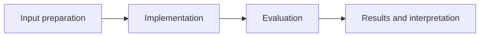
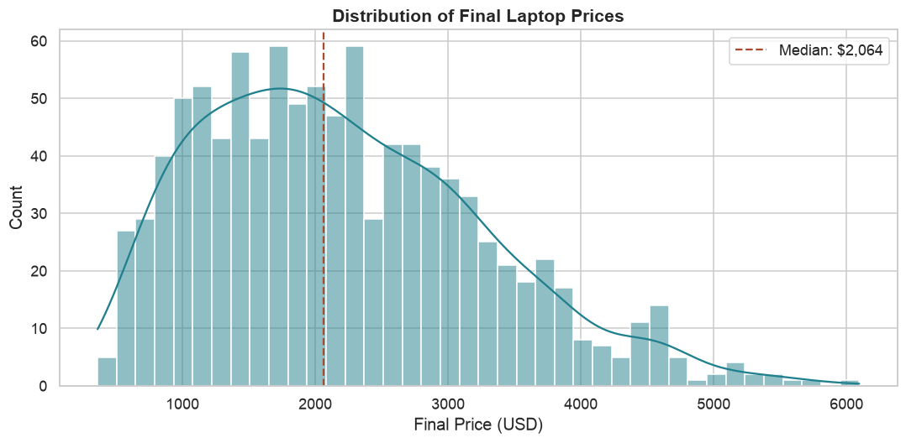

# Retail Sales Data Pipeline

**Feras Elghandour** · Technical case study

Clean heterogeneous retail transaction fields and produce repeatable pricing and revenue summaries.

## Implementation

Reusable type-cleaning and imputation functions, date and product-feature derivation, grouped exploratory analysis, and pricing/revenue visualizations.



## Evidence and results

The saved demonstration processes 1,000 generated laptop transactions. The release corrects chained-assignment imputation for current pandas behavior and includes functional checks on missing values and derived columns.

Results described as saved come from the retained experiment record. See [VALIDATION.md](VALIDATION.md) for the checks performed on this release and their scope.

## Fresh reproduction — October 17, 2026

Fresh execution completed all cleaning, feature derivation, summaries, and three charts on the retained 1,000-row generated fixture using pandas 3.0.6.

The environment versions, input hashes, and notebook hash are recorded in [results/reproduction.json](results/reproduction.json).



## Practical relevance

This project demonstrates reusable type-cleaning and imputation functions, date and product-feature derivation, grouped exploratory analysis, and pricing/revenue visualizations.
The implementation and evaluation make the trade-offs inspectable for technical review.

## Run locally

```sh
python -m venv .venv
source .venv/bin/activate
python -m pip install -r requirements.txt
jupyter lab analysis.ipynb
```

Prepare the inputs described in [DATA.md](DATA.md) first. Source validation is available without installing model dependencies:

```sh
python scripts/validate_source.py
```

Run the focused offline behavior checks with `python smoke_test.py` after installing the dependencies.

## Limitations

The fixture is synthetic. Brand-price differences and revenue patterns are properties of the generated example, not evidence about real retail performance or clients.

## Development

Changes should include a clear description of the behavior affected and verification appropriate to that behavior. Keep input data, credentials, model caches, and generated artifacts outside version control.
