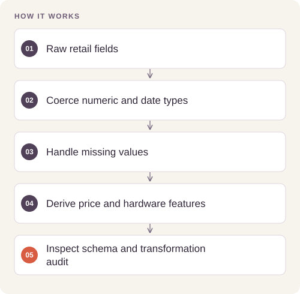

# Retail Sales Data Pipeline

Clean heterogeneous retail transaction fields and produce repeatable pricing and revenue summaries.

## Implementation

Reusable type-cleaning and imputation functions, date and product-feature derivation, grouped exploratory analysis, and pricing/revenue visualizations.




## Run the validated data pipeline

The reusable pipeline now rejects missing schemas, all-null numerics, invalid dates, missing GPU values and invalid hardware denominators. The retained1,000-row generated input preserves all rows, adds six derived fields and leaves no missing numeric values.

[Commands, artifacts and benchmark scope](BENCHMARKS.md) · [Versioned profiles](reproduction.json)


## Try a small example

A small offline fixture exercises the public implementation. It demonstrates the behavior shown below; it does not replace the historical dataset, benchmark or production validation.

After the local setup below, run from the repository root:

```sh
python examples/quickstart.py
```

The [example source](examples/quickstart.py), [captured output](examples/expected-output.txt) and [execution record](examples/environment.json) keep this demonstration inspectable. Floating-point values may vary with library versions.

Observed output from this run:

```text
{
  "fixture": "three generated laptop rows",
  "rating": [
    1.0,
    2.0,
    3.0
  ],
  "gpu": [
    0,
    1,
    0
  ],
  "months": [
    "2024-01",
    "2024-02",
    "2024-03"
  ],
  "original_missing": 1
}
```

## Evidence and results

The saved demonstration processes 1,000 generated laptop transactions. The release corrects chained-assignment imputation for current pandas behavior and includes functional checks on missing values and derived columns.

See [VALIDATION.md](VALIDATION.md) for the release checks and their scope.

## Fresh reproduction — October 17, 2026

Fresh execution completed all cleaning, feature derivation, summaries, and three charts on the retained 1,000-row generated fixture using pandas 3.0.6.

The environment versions, input hashes, and notebook hash are recorded in [results/reproduction.json](results/reproduction.json).


## Run locally

```sh
python -m venv .venv
source .venv/bin/activate
python -m pip install -r requirements.txt
jupyter lab analysis.ipynb
```

Prepare the inputs described in [DATA.md](DATA.md) first. Source validation is available without installing model dependencies:

```sh
python scripts/validate_source.py
```

Run the focused offline behavior checks with `python smoke_test.py` after installing the dependencies.

## Limitations

The fixture is synthetic. Brand-price differences and revenue patterns are properties of the generated example, not evidence about real retail performance or clients.
